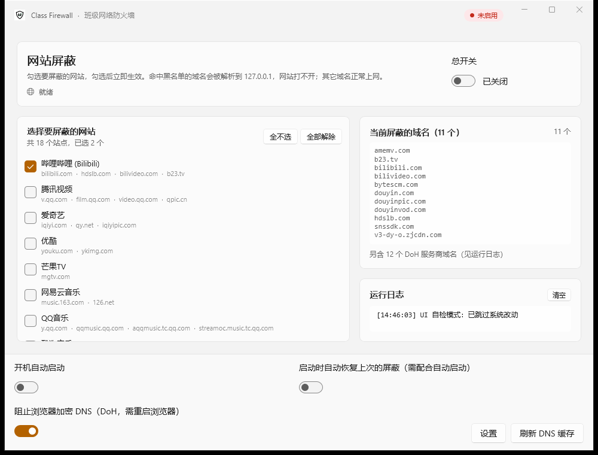
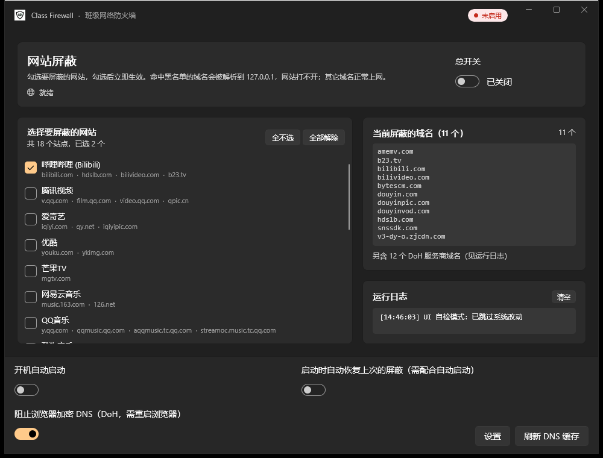
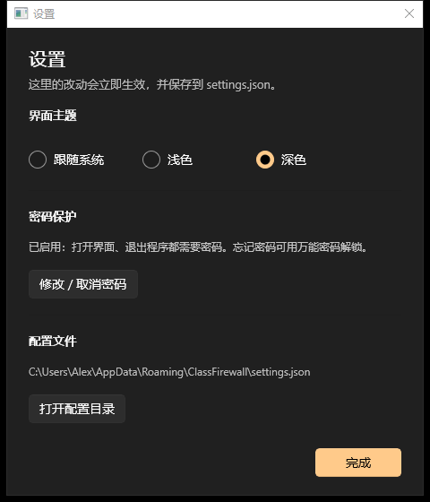
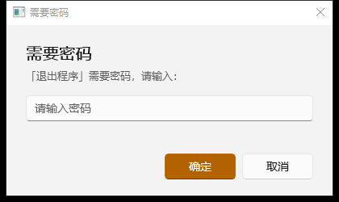

# Class Firewall (CFW) 班级网络防火墙

面向**班级**场景的 Windows 网站屏蔽工具。

管理员勾选要屏蔽的网站，使用者就访问不了；取消勾选立刻恢复。界面使用 **WinUI 3（Windows App SDK）** 重写，免安装，目标电脑无需预装 .NET 运行时和 Windows App Runtime。



<details>
<summary>深色主题 / 设置 / 密码框截图</summary>





</details>

## 原理

```
  浏览器 / 桌面应用
        │
        │  ① 查询 douyin.com
        ▼
  系统网卡 DNS 被指向 127.0.0.1:53
        │
        ▼
  Class Firewall
        │   ├─ DnsServer        本地 UDP 53 服务
        │   └─ DomainMatcher    域名后缀匹配黑名单
        │
        ├─ ② 命中黑名单 ──► 返回 127.0.0.1 ──► 网站打不开（连接被拒）
        │
        └─ ③ 未命中 ──────► 转发上游 + 缓存 60 秒 ──► 正常上网
                              （223.5.5.5 / 114.114.114.114 / 8.8.8.8）
```

### 拦截判定

判定的全部依据就是**域名的逐级后缀匹配**（规则见第四节），命中与否只有两条出路：

| 结果 | 动作 | 使用者看到 |
|---|---|---|
| 命中黑名单 | 直接返回 `127.0.0.1`，不向上游查询 | 网站打不开（连接被拒绝） |
| 未命中 | 转发上游，结果缓存 60 秒 | 正常上网 |

黑名单支持**实时更新**：勾选/取消勾选立刻同步到运行中的服务，不需要重启，也不需要点"应用"。

---

## 使用方法

1. 双击 `ClassFirewall.exe`
2. **勾选要屏蔽的网站** —— 勾上就生效
3. 需要时点「**刷新 DNS 缓存**」清掉系统的旧解析结果（只清系统缓存，浏览器自己还有一层缓存，要另行清理）
4. 想全部恢复点「**全部解除**」

> ⚠️ 启用屏蔽时会先检查 **53 端口**。如果有别的 DNS 服务占着（比如某些杀软、代理工具自带的 DNS），
> 程序会**结束那个进程**来腾端口 —— 但 `svchost` / `lsass` / `System` 这类系统关键进程会被跳过，不会被误杀。
> 这一行为会在日志和弹窗里明确提示。

界面上的四个开关：

| 开关 | 作用 |
|---|---|
| 总开关（启用屏蔽，本地 DNS 127.0.0.1:53） | 总开关。打开＝启动本地 DNS 并接管系统 DNS；关闭＝停止并还原 |
| 开机自动启动 | 用任务计划程序创建 `ClassFirewallAutoStart` 任务，登录时以最高权限运行、**免 UAC**；启动带 `-silent`，直接进托盘并按设置恢复屏蔽。**只勾这一项不够**，见下 |
| 启动时自动恢复上次的屏蔽 | 程序启动后自动按上次的勾选和开关状态恢复屏蔽 |
| 阻止浏览器加密 DNS（DoH） | **默认开启**。关掉浏览器「安全 DNS」并锁定，见下一节 |

按钮：顶部卡片下方的 `全不选`、`全部解除`，底部右侧的 `设置`（主题 / 密码 / 配置目录）、`刷新 DNS 缓存`。

配置文件：`%AppData%\ClassFirewall\settings.json`

### 主题

`设置` → `界面主题`：跟随系统 / 浅色 / 深色。选择会立刻生效并保存。

### 最小化到托盘

- 点**最小化**就把窗口缩到系统托盘（通知区域），不占任务栏；屏蔽照常运行。
- 点**关闭（×）**时，如果**设了密码**，也不退出而是缩到托盘 —— 否则使用者一点叉号就把屏蔽关掉了。
- 托盘图标：单击或双击打开主界面；右键菜单有「打开主界面」「退出程序」。
- 没设密码时，× 仍然是直接退出（保持原来的行为）。

### 密码保护

- **首次运行**会问一次「要不要设密码」，可以直接跳过 —— 不该拦着人用工具。之后随时可以在「设置」里改。
- 设了密码后，**打开界面**和**退出程序**都要输密码（含托盘菜单里的这两项）。
  为了不让密码拦不住程序本体，**退出校验放在窗口出现之前**，没解锁连界面都看不到。
- 密码用 **PBKDF2-SHA256（12 万次迭代 + 随机盐）** 存储，`settings.json` 里**只有哈希，没有明文**。
  连输 5 次错就退出程序。
- 开机自启**不会弹密码框**，否则登录时没人输密码会卡住。

---

### 把常见 DoH 服务商域名一起黑洞掉

12 个域名：`cloudflare-dns.com`（含 Chrome / Firefox 的默认 DoH 子域）、`one.one.one.one`、`dns.google`、`doh.opendns.com`、`dns.quad9.net`、`dns.nextdns.io`、`dns.adguard.com`、`doh.cleanbrowsing.org`、`dns.mullvad.net`、`doh.pub`、`dns.alidns.com`、`doh.360.cn`。

这一条**与浏览器策略无关**：浏览器即便开着「自动」模式的 DoH，也必须先解析 DoH 服务器的域名，这一步被黑洞掉就会退回系统 DNS。

### ⚠️ 注意事项

- **策略需要重启浏览器才生效**（有的情况要重启一次系统）。
- 改注册表需要管理员权限。
- 关闭这个开关、或点「全部解除」时，程序**只删自己写的那条值**；别人（或组策略）设的其它策略一律不动。

---

## 构建与运行

### 环境要求

| 用途 | 需要什么 |
|---|---|
| 命令行构建 / 运行 | .NET 8 SDK（`dotnet build` / `dotnet run`） |
| Visual Studio 打开 | VS 2022 17.10+ 或 VS 2026；必须装 **.NET 桌面开发** 工作负载 |
| VS 里 F5 调试 | 同上；若想让 XAML 编译走 VS 原生路径，再加装 **使用 C++ 的桌面开发**（或「Windows 应用程序开发」）工作负载 |

> **为什么有的机器上 VS 打不开 / 生成失败？**
> WinUI 3 的 XAML 编译目标在「VS 的 MSBuild」下会去 `%VSInstallRoot%\VC\Tools\MSVC` 找 MSVC；
> 没装 C++ 工作负载时这个目录不存在，任务直接抛 `DirectoryNotFoundException`，
> VS 里就表现为项目加载失败。命令行 `dotnet build` 因为走 Core MSBuild，不受影响。
>
> 本项目在 `ClassFirewall.csproj` 里做了兼容：检测不到 MSVC 时给 `VCInstallPath32/64` 一个占位值，
> 让 C# 项目跳过 vcmeta 探测（托管项目本来就无需它）。装了 C++ 工作负载后会自动走 VS 原生路径。

### 命令行

```bat
dotnet build ClassFirewall.sln -c Debug -p:Platform=x64
dotnet run   --project ClassFirewall.csproj -p:Platform=x64
```

### 发布（自包含，目标机免装运行时）

```bat
publish.bat
```

输出 `publish\win-x64\`，**整个目录**拷到目标机，双击 `ClassFirewall.exe` 即可。
实测约 **207 MB / 503 个文件**（.NET + Windows App SDK 全部自包含）。

> WinUI 3 依赖原生 DLL（`Microsoft.ui.xaml.dll` 等），**做不到单文件 exe**。
> 这是与旧 WinForms 版最大的发布差异：WinForms 版曾能打成单个 exe。
>
> 想瘦身：把 csproj 里的 `WindowsAppSDKSelfContained` 和 `SelfContained` 改成 `false`，
> 体积会降到几十 MB，但目标机必须预装 .NET 8 运行时和 Windows App Runtime。

程序需要管理员权限（`app.manifest` 里 `requireAdministrator`），双击会弹 UAC。

---

## 匹配规则（新增网站看这里）

匹配方式是**逐级后缀匹配**：

> 清单里写 `douyin.com`，那么 `douyin.com` 及其**任意深度子域名**全部命中 ——
> `www.douyin.com`、`v.douyin.com`、`irrelevant.sub.domain.douyin.com` 都会被拦。

**所以新增站点时，优先只写基础域名（两段式），不要逐个列举子域名。** 在 `SiteCatalog.cs` 里加一条记录即可：

```csharp
new SiteInfo
{
    Name = "example",
    Domains = new[]
    {
        "example.com",      // 主站：www / m / api 全部由它覆盖
        "examplecdn.com"    // 独立 CDN 域名
    }
}
```

新增后列表里会自动出现（界面绑定的是 `SiteCatalog.Sites`）。

---

## 能力边界

| 场景 | 能否拦住 | 说明 |
|---|---|---|
| 浏览器访问（走系统 DNS） | ✅ | 主要场景 |
| 桌面应用走系统 DNS | ✅ | |
| 浏览器 **DoH / 安全 DNS** | ✅ | **勾选「阻止浏览器加密 DNS」后**可拦；不勾选则被绕过 |
| 应用**硬编码 DNS**（如自带 8.8.8.8） | ❌ | 不走系统 DNS 就绕过（DoH 开关只能管浏览器） |
| **VPN / 代理** | ❌ | 流量走隧道 |
| **硬编码 IP 直连** | ❌ | 没有域名可解析 |
| 浏览器缓存 / 系统 DNS 缓存 | ⚠️ | 点「刷新 DNS 缓存」；浏览器自己还有一层缓存 |

---

## 项目结构

| 文件 | 作用 |
|---|---|
| `Program.cs` | 进程入口（自定义 `Main`，解析 `-silent`、装崩溃日志、单实例锁） |
| `App.xaml` / `App.xaml.cs` | WinUI 应用对象、启动前解锁、创建主窗口 |
| `MainWindow.xaml` / `MainWindow.xaml.cs` | 主界面与业务逻辑（XAML + code-behind） |
| `ViewModels.cs` | 站点列表项 `SiteItem`（可观察，供 CheckBox 双向绑定） |
| `DialogWindow.cs` | 对话框基类（独立小窗口，主窗口尚未创建时也能弹） |
| `PasswordDialog.cs` | 密码输入 / 设置密码对话框 |
| `MessageWindow.cs` | 通用提示 / 确认框（替代 MessageBox） |
| `SettingsDialog.cs` | 设置：主题、密码、打开配置目录 |
| `TrayIcon.cs` | 系统托盘（`Shell_NotifyIcon` + 原生右键菜单） |
| `WindowCloseHook.cs` | 拦截 `WM_CLOSE`：设了密码时关窗口＝收进托盘 |
| `ThemeHelper.cs` | 主题（跟随系统 / 浅色 / 深色） |
| `SiteCatalog.cs` | **站点黑名单清单**（新增网站改这里） |
| `DomainMatcher.cs` | 黑名单匹配（逐级后缀匹配，全项目唯一的匹配实现） |
| `BrowserDohGuard.cs` | 关闭浏览器「安全 DNS」的企业策略 + DoH 服务商域名清单 |
| `PasswordGate.cs` | 解锁密码的 PBKDF2 哈希与校验 + 万能密码 |
| `DnsServer.cs` | 本地 DNS 服务器（UDP 53，含缓存与上游转发） |
| `DnsConfigurator.cs` | 切换 / 还原系统网卡 DNS，刷新 DNS 缓存 |
| `PortHelper.cs` | 检测并释放 53 端口占用（保护系统关键进程不被误杀） |
| `SettingsStore.cs` | 配置持久化 |
| `AutoStartManager.cs` | 任务计划程序开机自启 |
| `LegacyHostsCleaner.cs` | 升级清理：摘掉旧版本写在 hosts 里的屏蔽块 |
| `LegacyFirewallCleaner.cs` | 升级清理：删掉旧版本写入的防火墙规则 |
| `app.manifest` | 管理员权限（**UTF-8 无 BOM，首行直接是 `<assembly>`，无 XML 声明**） |
| `publish.bat` | 一键发布（`chcp 65001`） |

> 旧的 WinForms 界面（`MainForm.cs` / `MainForm.Designer.cs` / 旧 `PasswordDialog.cs`）
> 已不在仓库中，需要对照时看 git 历史（`main` 分支）。

---

## 如何彻底清理

| 残留 | 清理方式 |
|---|---|
| 系统 DNS 被改成 127.0.0.1 | **正常关闭程序**即自动还原为 DHCP。若曾异常终止：设置 → 网络 → 网卡属性 → IPv4 → 自动获得 DNS，或点程序的「全部解除」 |
| 浏览器「安全 DNS」策略 | 取消「阻止浏览器加密 DNS」勾选，或点「全部解除」。也可手工删除（见下表） |
| 开机自启任务 | 取消「开机自动启动」勾选；或 `schtasks /Delete /TN ClassFirewallAutoStart /F` |
| 密码 | `设置` → 修改 / 取消密码 → 先输原密码 → 新密码留空并确定即可取消；或直接删 `settings.json` |
| 配置 | 删除 `%AppData%\ClassFirewall\` |

手工删除浏览器策略（管理员权限）：

```bat
reg delete "HKLM\SOFTWARE\Policies\Microsoft\Edge" /v DnsOverHttpsMode /f
reg delete "HKLM\SOFTWARE\Policies\Google\Chrome" /v DnsOverHttpsMode /f
reg delete "HKLM\SOFTWARE\Policies\BraveSoftware\Brave" /v DnsOverHttpsMode /f
reg delete "HKLM\SOFTWARE\Policies\Mozilla\Firefox" /v DNSOverHTTPS /f
```

---

**本项目使用 LGPLv3 进行分发**
